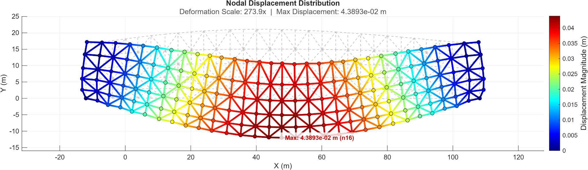
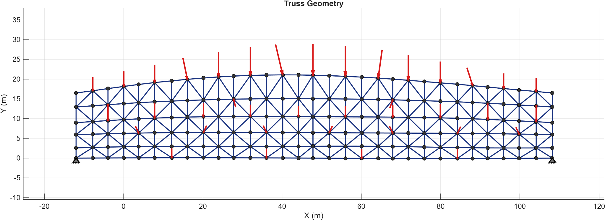
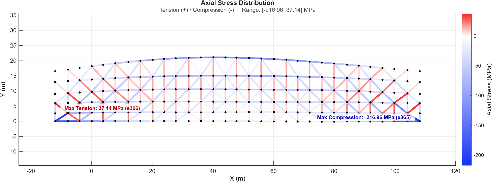
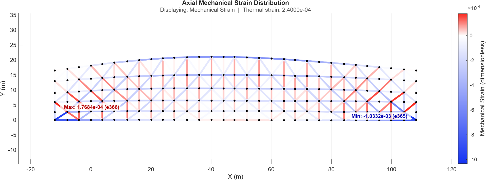
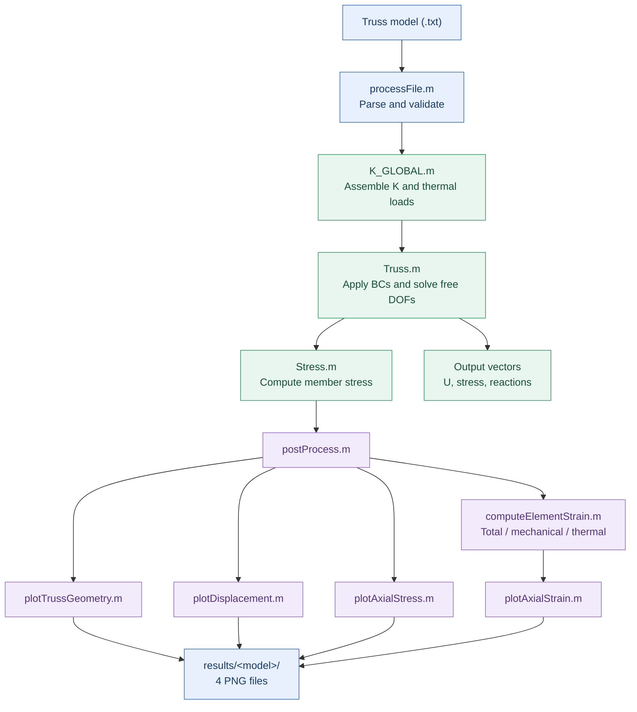

<div align="center">

# 2D Truss FEM Solver & Visualization

**A transparent, reproducible finite element solver for planar truss structures, built in MATLAB.**

*From a plain-text structural model to displacements, reactions, axial stress, axial strain, and high-resolution engineering figures.*


[Quick Start](#quick-start) · [Examples](#examples) · [Visualization](#visualization-gallery) · [Theory](#finite-element-formulation) · [Validation](#verification-and-validation) · [Limitations](#scope-and-limitations)

</div>

---

## Overview

This project solves **small-displacement, linear-elastic, two-dimensional truss models** with the finite element method (FEM). Define the structure using a readable `.txt` file, then run one MATLAB command to solve the system and export four figures. The code is deliberately organized into distinct input, assembly, solution, and post-processing stages so that the mathematics can be inspected and tested.

### Highlights

- **Plain-text models:** nodes, connectivity, restraints, forces, and material properties.
- **General 2D trusses:** arbitrary valid planar arrangements of straight, pin-connected axial members.
- **Mechanical and thermal loading:** nodal loads and a uniform positive or negative temperature change.
- **Boundary conditions:** fixed degrees of freedom, partial restraints, and prescribed nonzero displacements.
- **Engineering results:** nodal displacements, support reactions, signed member stress, and total/mechanical/thermal strain.
- **Automated visualization:** geometry, magnified deformed shape, axial stress, and axial strain saved as PNG.
- **Built-in checks:** descriptive errors for malformed models and unstable free-DOF stiffness matrices.
- **Reproducibility:** 13 MATLAB regression groups plus an optional independent Python/SciPy reference implementation.

> [!IMPORTANT]
> This is a **linear axial-bar solver**, not a general structural design or finite element package. Buckling, bending, yielding, and geometric/material nonlinearities are **not** modeled. See [Scope and limitations](#scope-and-limitations).

## Visualization gallery

The figures below were generated in MATLAB from the included **186-node / 485-element** example, `input matlab files/test_1.txt`. Figures are exported automatically; the deformation graphic uses a stated magnification factor for readability.

**Deformed shape with nodal displacement magnitude**



| Original model and loads | Signed axial stress |
|:---:|:---:|
|  |  |

**Mechanical axial strain**



The displacement field is **nodal**; axial stress and axial strain are **constant within each two-node linear truss element**. Red indicates tension, blue indicates compression, and white is the zero point in signed contour plots.

## Quick start

### Requirements

- **MATLAB** with `exportgraphics` support (**R2020a or newer recommended**).
- No specialized MATLAB toolboxes required by the solver.
- Optional: **Python 3, NumPy, and SciPy** for the independent reference validator.

### Run a bundled example

1. Download or clone the project and open its root directory as the MATLAB **Current Folder**.
2. Paste the following into the MATLAB Command Window:

```matlab
opts = struct();
opts.enabled = true;
opts.showFigures = false;
opts.imageDPI = 300;

[U, stress, reactions] = Truss( ...
    'input matlab files/problem-2-with-thermal.txt', opts);
```

3. Find the four generated images at:

```text
results/
  problem-2-with-thermal/
    01_truss_geometry.png
    02_displacement.png
    03_axial_stress.png
    04_axial_strain.png
```

**Interactive file selection:** Run `Truss` with no arguments to open a `.txt` file chooser. **Calculations only:** set `opts.enabled = false` to disable image export.

### Inspect the numerical output

```matlab
% U stores [Ux1, Uy1, Ux2, Uy2, ...] in meters.
nodeDisplacement = hypot(U(1:2:end), U(2:2:end));
[maxDisplacement, maxNode] = max(nodeDisplacement);

% Stress is signed element-wise axial stress in pascals.
[maxTension, tensionElement] = max(stress);
[maxCompressionMagnitude, compressionElement] = min(stress);

fprintf('Max displacement: %.6g m at n%d\n', maxDisplacement, maxNode);
fprintf('Max tension: %.3f MPa at e%d\n', maxTension/1e6, tensionElement);
fprintf('Max compression: %.3f MPa at e%d\n', ...
    maxCompressionMagnitude/1e6, compressionElement);
```

| Output | Size | Meaning | Units |
|---|---|---|---|
| `U` | `2N × 1` | Nodal `Ux`, `Uy` in node order | m |
| `stress` | `M × 1` | Signed member axial stress (+ tension, − compression) | Pa |
| `reactions` | `2N × 1` | Mechanical support reactions at constrained DOFs; zero at free DOFs | N |

Here, `N` is the number of nodes and `M` is the number of members.

## Architecture

The solver and renderer are separated. Post-processing consumes the computed solution rather than solving another FEM problem.



### Main source files

| File | Responsibility |
|---|---|
| `Truss.m` | Main entry point, partitioned solution, results, console output |
| `processFile.m` | Input parsing, consistency checks, force aggregation |
| `K_GLOBAL.m` | Global stiffness matrix and equivalent nodal thermal load |
| `Stress.m` | Signed axial stress from mechanical member strain |
| `computeElementStrain.m` | Total, thermal, and mechanical axial strains |
| `postProcess.m` | Plot settings, folders, error isolation, plot orchestration |
| `plotTrussGeometry.m` | Nodes, members, supports, external loading |
| `plotDisplacement.m` | Original/deformed geometry and nodal displacement colors |
| `plotAxialStress.m`, `plotAxialStrain.m` | Memberwise signed contours and extrema |
| `trussColorMap.m`, `trussFigure.m` | Shared color-map and figure utilities |
| `run_verification_tests.m` | MATLAB regression suite |
| `scripts/reference_validate.py` | Optional independent NumPy/SciPy FEM checks |

## Input-file format

A model is a comma-separated **plain-text file**, divided into labeled sections:

| Section | Record | Meaning |
|---|---|---|
| `#node` | `n1,0,0` | Node ID and `(x,y)` coordinates |
| `#element` | `e1,1,2` | Member ID and its two node indices |
| `#boundry_condition` | `n1,0,0` | Prescribed `(Ux,Uy)` at a node |
| `#force` | `n3,0,-10000` | Applied nodal `(Fx,Fy)` |
| `#metadata` | `E,210e9` | Material and thermal constants |

The original spelling **`#boundry_condition`** is intentionally supported for existing models; the corrected `#boundary_condition` also works.

### Degree-of-freedom convention

- `n1,0,0` fixes both translations of node 1 (pin in a 2D truss).
- `n2,,0` leaves the horizontal translation **free** but fixes vertical translation (vertical restraint / horizontal roller).
- `n2,0,` fixes horizontal translation and leaves vertical translation free.
- `n3,0.002,0` imposes a **+2 mm** horizontal displacement and zero vertical displacement.
- Use an empty entry or `NaN` for a free DOF. A numerical `0` means **constrained to zero**, not free.

Sections may be ordered differently. The force section is optional, and multiple force records at the same node are added. IDs must be **sequential and ordered**, beginning at `n1` for nodes and `e1` for elements. Node indices in connectivity must refer to existing nodes.

### Units and parameters

All built-in plot labels assume **SI units**. Keep input units internally consistent:

| Property | Key | Unit | Notes |
|---|---|---|---|
| Coordinates | `x`, `y` | m | Member geometry |
| Force | `Fx`, `Fy` | N | Positive directions are +X, +Y |
| Young's modulus | `E` | Pa | Required; strictly positive |
| Member area | `A` | m² | Required; strictly positive |
| Thermal expansion | `alpha` | 1/K | Optional; defaults to 0 |
| Temperature difference | `T` | °C or K difference | Optional; defaults to 0; signed |

**Current material assumption:** `E`, `A`, `alpha`, and `T` are global scalar inputs shared by every member. Per-member materials, areas, and temperature fields are not implemented.

## Examples

### Example 1: Three-bar triangular truss

A small, inspectable demonstration is provided in [`examples/triangle_3node.txt`](examples/triangle_3node.txt).

```text
         n3 (2, 3)
          /    \
       e2/      \e3
        /        \
 n1 (0, 0)----n2 (4, 0)
         e1
    pin           roller
```

```text
#node
n1,0,0
n2,4,0
n3,2,3

#element
e1,1,2
e2,1,3
e3,2,3

#boundry_condition
n1,0,0
n2,,0

#force
n3,0,-10000

#metadata
E,210e9
A,600e-6
```

```matlab
[U, S, R] = Truss('examples/triangle_3node.txt', ...
    struct('enabled', true, 'showNodeIDs', true));
```

For this pin–roller case, under a 10 kN downward apex load, an independent linear-truss calculation gives these approximate **reference values**:

| Quantity | Reference |
|---|---:|
| `Ux(n3)` | `+5.2910e-5 m` |
| `Uy(n3)` | `-2.4194e-4 m` |
| Bottom chord `e1` | `+5.5556 MPa` (tension) |
| Diagonals `e2`, `e3` | `-10.0154 MPa` each (compression) |
| Vertical reactions at `n1`, `n2` | `+5,000 N` each |

These numbers are an additional worked-example reference, not a claim that the new fixture is included in the existing 13-group MATLAB test script.

### Example 2: Thermomechanical analysis

The bundled [`problem-2-with-thermal.txt`](input%20matlab%20files/problem-2-with-thermal.txt) combines nodal mechanical forces and a uniform temperature change. Run:

```matlab
opts = struct('strainType', 'mechanical', 'imageDPI', 300);
[U, S, R] = Truss('input matlab files/problem-2-with-thermal.txt', opts);
```

Use `strainType = 'total'`, `'mechanical'`, or `'thermal'` to change which strain field appears in the fourth image. Positive `T` represents heating; negative `T` represents cooling. The model treats `T` as **ΔT**, not absolute temperature.

### Example 3: Large benchmark with 186 nodes

The included [`test_1.txt`](input%20matlab%20files/test_1.txt) contains 186 nodes, 485 elements, nonuniform nodal forces, prescribed supports, and thermal loading. It is particularly useful for testing output readability and the solver on a relatively dense 2D truss.

```matlab
opts = struct();
opts.enabled = true;
opts.showNodeIDs = false;
opts.showElementIDs = false;
opts.showForceLabels = 'auto';
opts.imageDPI = 300;
[U, S, R] = Truss('input matlab files/test_1.txt', opts);
```

| Metric | Independent FEM reference | Location |
|---|---:|---|
| Peak nodal displacement | **0.043893256 m** | `n16` |
| Maximum axial tension | **+37.137045 MPa** | `e366` |
| Maximum axial compression | **−216.964007 MPa** | `e365` |
| Nodes / members | **186 / 485** | Entire model |

These reference results were also reproduced in the MATLAB outputs supplied for the regression review.

## Finite element formulation

Every member is a straight **two-node axial truss element** with two translational degrees of freedom at each node:

$$
\mathbf{u}_e = [u_{ix}, u_{iy}, u_{jx}, u_{jy}]^T
$$

For element length $L$, direction cosines $c = (x_j-x_i)/L$, $s = (y_j-y_i)/L$, and $\mathbf{b}=[-c,-s,c,s]$, the element stiffness is

$$
\mathbf{k}_e = \frac{EA}{L}\mathbf{b}^T\mathbf{b}.
$$

The uniform-temperature equivalent member load is

$$
\mathbf{f}_{\mathrm{th},e}=EA\alpha\Delta T\,\mathbf{b}^T.
$$

After assembly, prescribed displacements are applied using an explicit free/constrained DOF partition:

$$
\mathbf{K}_{ff}\mathbf{U}_{f} = \mathbf{F}_{\mathrm{ext},f}+\mathbf{F}_{\mathrm{th},f}-\mathbf{K}_{fc}\mathbf{U}_{c}.
$$

The total, thermal, and mechanical axial strains are

$$
\varepsilon_{\mathrm{total},e}=\frac{\mathbf{b}\mathbf{u}_e}{L},\qquad
\varepsilon_{\mathrm{thermal},e}=\alpha\Delta T,\qquad
\varepsilon_{\mathrm{mechanical},e}=\varepsilon_{\mathrm{total},e}-\varepsilon_{\mathrm{thermal},e}.
$$

Consequently, axial stress and constrained reactions are

$$
\sigma_e=E\varepsilon_{\mathrm{mechanical},e},\qquad
\mathbf{R}_c=\left(\mathbf{K}\mathbf{U}-\mathbf{F}_{\mathrm{ext}}-\mathbf{F}_{\mathrm{th}}\right)_c.
$$

This distinction matters: **a freely expanding member can have nonzero total strain but zero mechanical stress**. Cooling and nonzero settlement are handled through the same linear system, without ad hoc sign corrections.

## Visualization settings

Supply options as the second argument to `Truss`:

```matlab
opts = struct();
opts.enabled = true;             % Generate figures
opts.showFigures = false;        % Export without opening interactive windows
opts.showNodeIDs = false;        % Useful for large models
opts.showElementIDs = false;
opts.showSupports = true;
opts.showForces = true;
opts.showForceLabels = 'auto';   % Suppress labels when >12 loaded nodes
opts.deformationScale = [];      % [] / 'auto' or a nonnegative numeric factor
opts.strainType = 'mechanical';  % 'total', 'mechanical', or 'thermal'
opts.imageDPI = 300;
opts.outputDir = '';             % Set a custom results root if needed
```

If `opts.outputDir = 'my_exports'`, an input called `bridge.txt` is exported under `my_exports/bridge/`. Automatic deformation amplification affects **drawing coordinates only**, not the computed displacement vector or figure colorbar values.

The drawing defaults aim to remain legible for dense models: node labels are on by default only for models with **40 nodes or fewer**, and magnitude labels on force arrows are hidden automatically above **12 loaded nodes**. Figures adapt to wide or tall geometry.

## Verification and validation

Run the MATLAB regression suite from the project root:

```matlab
run('run_verification_tests.m')
```

The suite performs **13 regression groups**, covering:

| Category | Coverage |
|---|---|
| Reference structures | 4 bundled models, including the 186/485 benchmark |
| Constitutive checks | `stress = E × mechanical strain`, thermal/total strain identities |
| Static equilibrium | Reactions, global balance, free-DOF residual |
| Signed thermal behavior | Free expansion and contraction, restrained cooling |
| Essential boundary conditions | Prescribed nonzero displacement and partial supports |
| Force application | External force applied directly at a restrained DOF |
| Stability | Singular/mechanism detection |
| Input handling | 11 malformed cases, missing file, repeated forces |
| Graphics | Diverging color maps and four MATLAB PNG exports |

A successful run ends with:

```text
===== SUCCESS: 13 regression groups passed =====
```

**Verification status (October 2026):** All 13 groups completed successfully in the MATLAB run reported during project testing. The independently written Python/SciPy reference calculations also passed for the included benchmarks. These are test-specific verification results, **not** a blanket certification for arbitrary structural designs.

For optional reference checks:

```bash
python -m pip install numpy scipy
python scripts/reference_validate.py
```

See [`TEST_REPORT.md`](TEST_REPORT.md) for the original revision history, provenance, defects corrected, and test limitations. Its initial note that the revised MATLAB code had not yet been executed describes the **earlier review environment**; the subsequent user-run MATLAB suite above completed successfully.

## Repository structure

```text
matlab-truss-fem/
├── README.md
├── TEST_REPORT.md
├── .gitignore
├── Truss.m
├── processFile.m
├── K_GLOBAL.m
├── Stress.m
├── computeElementStrain.m
├── postProcess.m
├── plotTrussGeometry.m
├── plotDisplacement.m
├── plotAxialStress.m
├── plotAxialStrain.m
├── trussColorMap.m
├── trussFigure.m
├── run_verification_tests.m
├── input matlab files/
│   ├── problem-1.txt
│   ├── problem-2-without-thermal.txt
│   ├── problem-2-with-thermal.txt
│   └── test_1.txt
├── examples/
│   └── triangle_3node.txt
├── scripts/
│   └── reference_validate.py
├── docs/
│   └── images/
│       ├── 01_truss_geometry.png
│       ├── 02_displacement.png
│       ├── 03_axial_stress.png
│       └── 04_axial_strain.png
└── results/                  # Generated, excluded by .gitignore
```

## Errors and troubleshooting

| Symptom | Likely cause / action |
|---|---|
| `Truss:InputError` | Check section names, sequential IDs, positive `E` and `A`, finite numbers, member connectivity, and file path. |
| `Truss:SingularSystem` | The structure contains a mechanism, insufficient restraints, or a severely ill-conditioned stiffness matrix. |
| No output figures | Check `opts.enabled`, the output directory, and individual export messages in the Command Window. |
| MATLAB cannot find `Truss` | Make the project root the **Current Folder**, or add it to the MATLAB path. |
| Tiny shape change | This is normal for a stiff structure; read the displayed deformation scale and the actual displacement numbers. |
| Compression contour dominates | Negative stress is physically dominant for that example; the colormap retains zero at white and an actual asymmetric data range. |
| Only the first few nodes visible | Check whether `showNodeIDs` was automatically disabled for a model above 40 nodes. |

## Scope and limitations

This implementation assumes:

- 2D, pin-connected, straight, **axial-force-only** truss members.
- Linear elastic, small-strain/small-displacement response.
- A common material modulus, area, thermal expansion coefficient, and uniform `ΔT` for all members.
- Static analysis with nodal applied forces and translational constraints.
- Dense global stiffness assembly; very large models may be memory- or CPU-intensive.

It **does not** calculate beam bending or shear, member buckling or post-buckling, plasticity, fracture, dynamic response, distributed loads, thermal gradients, per-member properties, or geometric nonlinear effects. A compressive stress result is **not** a buckling-capacity check. Engineering design decisions require additional independent verification and applicable design standards.

## Potential future improvements

- Sparse stiffness assembly and performance profiling for larger trusses.
- Member-by-member `E`, `A`, and `alpha` definitions.
- Nodal or elementwise temperature fields.
- CSV/JSON/MAT result exports and per-element axial force tables.
- Consistent benchmark comparisons against external FEM tools.
- Continuous integration for the MATLAB test suite.
- Configurable plot labels, color legends, and improved member visibility near zero-valued contours.

## Contributing

Bug reports and focused pull requests should include a minimal `.txt` reproducer, the expected physical behavior, the MATLAB version, and a test when possible. Avoid mixing solver numerical changes with visualization-only changes unless both are required for correctness.

## License

**No license has been selected for this repository yet.** Add a `LICENSE` file that reflects the owner's intended terms before describing the project as open-source or permitting third-party reuse. Public GitHub visibility by itself does not grant a software license.

---

<div align="center">

**Readable models · Inspectable FEM mathematics · Reproducible checks · Automatic visual results**

</div>
